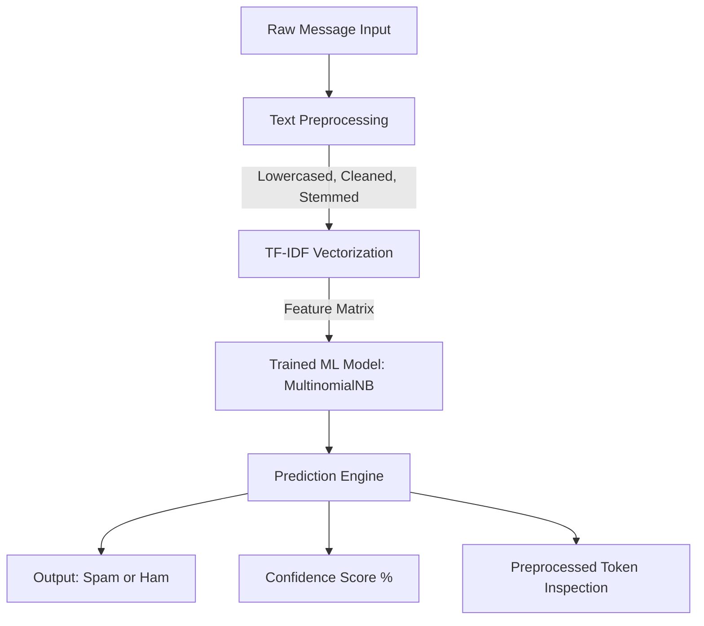

# 🛡️ Email Spam Classifier

[](https://www.python.org/)
[](https://flask.palletsprojects.com/)
[](https://scikit-learn.org/)
[](https://www.nltk.org/)
[](LICENSE)

A production-ready Natural Language Processing (NLP) web application that evaluates email and SMS messages to accurately detect spam versus legitimate (ham) correspondence. Built with **Flask**, **Scikit-Learn**, and **NLTK**, featuring a modern dark-mode glassmorphic dashboard and interactive model training analytics.

---

## 📑 Table of Contents

- [Overview](#-overview)
- [Key Features](#-key-features)
- [System Architecture](#-system-architecture)
- [NLP Preprocessing Pipeline](#-nlp-preprocessing-pipeline)
- [Machine Learning Models & Evaluation](#-machine-learning-models--evaluation)
- [Project Directory Structure](#-project-directory-structure)
- [Prerequisites & Requirements](#-prerequisites--requirements)
- [Installation & Setup](#-installation--setup)
- [Model Training & Analytics Generation](#-model-training--analytics-generation)
- [Running the Web Application](#-running-the-web-application)
- [API Reference](#-api-reference)
- [Testing Examples](#-testing-examples)
- [Author & Credits](#-author--credits)

---

## 🔍 Overview

Spam emails not only clutter inboxes but frequently serve as vectors for phishing attacks, credential harvesting, and malware delivery. This project implements a machine learning solution that vectorizes text using **TF-IDF (Term Frequency-Inverse Document Frequency)** and leverages a **Multinomial Naive Bayes** classifier trained on the SMS/Email Spam Collection corpus.

In addition to serving real-time predictions, the application provides an interactive analytics suite visualizing spam term densities, keyword distributions, confusion matrices, and benchmark comparisons against other algorithms (Logistic Regression and Support Vector Machines).

---

## ✨ Key Features

- **⚡ Real-Time Classification**: Instant analysis of raw email and SMS text with confidence scoring.
- **🧠 Custom NLP Pipeline**: Structured normalization using regex cleaning, stopword filtering, and Porter stemming.
- **📊 Comparative Model Benchmarking**: Evaluates accuracy, precision, recall, and F1-score across:
  - Multinomial Naive Bayes (Production Model)
  - Logistic Regression
  - Support Vector Machine (SVM)
- **📈 Embedded Analytics Dashboard**:
  - **Spam Word Cloud**: High-density visualization of the most frequent spam triggers.
  - **Top 15 Keywords**: Bar chart of prominent spam indicators.
  - **Model Performance**: Multi-model accuracy comparison.
  - **Confusion Matrix**: Visual error rates detailing True/False Positives and Negatives.
  - **Class Distribution**: Ratio analysis of legitimate vs. spam messages.
- **🎨 Modern Glassmorphic Dark UI**:
  - Custom CSS tokens, animated ambient blur spheres, and responsive layouts.
  - Dynamic character count and animated confidence meter.
  - Inspection card displaying preprocessed stemmed tokens.
- **🛡️ Data Leakage Prevention**: Strict pipeline ordering with `train_test_split` executed before TF-IDF vectorizer fitting.

---

## 🏗️ System Architecture



---

## 🔬 NLP Preprocessing Pipeline

Text normalization is handled in [`preprocess.py`](file:///C:/Users/kanis/OneDrive/Desktop/Email%20spam%20classifier/preprocess.py) via a robust sequence of transformations:

1. **Lowercasing**: Normalizes all characters to avoid duplicate vocabulary entries (e.g., `"FREE"` vs. `"free"`).
2. **Punctuation Removal**: Replaces punctuation marks with whitespace using `string.punctuation` translation table to avoid merging adjacent words (e.g., `"spam/ham"` $\rightarrow$ `"spam ham"`).
3. **Digit Removal**: Strips numeric values using regular expressions (`\d+`) to focus on semantic content.
4. **Tokenization**: Splits messages into individual tokens based on whitespace.
5. **Stopword Elimination**: Filters out non-informative English words using Scikit-Learn's built-in `ENGLISH_STOP_WORDS` (stored in a hash set for $O(1)$ lookups, requiring zero external corpus downloads for serverless deployments).
6. **Porter Stemming**: Reduces morphological variations to their root forms (e.g., `"winning"` $\rightarrow$ `"win"`, `"prizes"` $\rightarrow$ `"prize"`).
7. **Whitespace Compression**: Strips extraneous padding and collapses repeated spaces into single intervals.

---

## 🤖 Machine Learning Models & Evaluation

The dataset is partitioned into an **80/20 train-test split** with class stratification (`stratify=y`) and fixed random seeds (`random_state=42`) for reproducibility.

### Evaluated Algorithms

| Model | Primary Characteristics | Target Use Case |
| :--- | :--- | :--- |
| **Multinomial Naive Bayes** | Probabilistic model assuming conditional independence between features given the class; highly effective for sparse text matrices. | **Production Model** (high precision, low false-positive rate, minimal latency) |
| **Logistic Regression** | Linear classification mapping linear feature combinations to logistic probabilities using $L_2$ regularization. | Baseline comparison and linear separability evaluation |
| **Support Vector Machine (SVC)** | Finds the optimal hyperplane maximizing the margin between classes in high-dimensional feature spaces. | Non-linear boundary benchmarking with calibrated probabilities |

### Why Precision & F1-Score Matter

In email spam filtering, a **False Positive** (classifying an important legitimate email as Spam) is significantly worse than a **False Negative** (letting a spam message slip into the inbox). The production **Multinomial Naive Bayes** model is prioritized for its exceptional precision, ensuring legitimate communications are protected.

---

## 📁 Project Directory Structure

```text
Email spam classifier/
│
├── api/
│   └── index.py               # Vercel serverless function entrypoint
├── app.py                     # Flask web server and REST API endpoints
├── preprocess.py              # Modular NLP text cleaning and Porter Stemmer pipeline
├── train_model.py             # Model training, benchmarking, and visualization generator
├── vercel.json                # Vercel serverless deployment routing and bundle configuration
│
├── spam.csv                   # SMS/Email Spam Collection dataset
├── model.pkl                  # Serialized production Multinomial Naive Bayes model
├── vectorizer.pkl             # Serialized 5,000-feature TF-IDF vectorizer
│
├── requirements.txt           # Python dependencies
├── README.md                  # Project documentation
│
├── templates/
│   └── index.html             # Dashboard frontend template (Jinja2)
│
└── static/
    ├── style.css              # Custom dark-theme glassmorphism stylesheet
    ├── script.js              # Asynchronous fetch client, animation, and tab manager
    └── images/                # Generated evaluation plots
        ├── confusion_matrix.png
        ├── model_accuracy_comparison.png
        ├── spam_vs_ham_count.png
        ├── top_spam_keywords.png
        └── wordcloud_spam.png
```

---

## 📦 Prerequisites & Requirements

- **Python 3.9+** installed on your system.
- Standard tools: `pip` and `git`.

### Python Dependencies

All packages are pinned in [`requirements.txt`](file:///C:/Users/kanis/OneDrive/Desktop/Email%20spam%20classifier/requirements.txt):

```text
flask
pandas
numpy
scikit-learn
nltk
matplotlib
seaborn
wordcloud
```

---

## 🚀 Installation & Setup

### 1. Clone the Repository

```bash
git clone https://github.com/your-username/email-spam-classifier.git
cd "email-spam-classifier"
```

### 2. Create a Virtual Environment

It is recommended to use an isolated Python environment:

**On Windows (PowerShell):**
```powershell
python -m venv .venv
.\.venv\Scripts\Activate.ps1
```

**On macOS / Linux:**
```bash
python3 -m venv .venv
source .venv/bin/activate
```

### 3. Install Required Dependencies

```bash
pip install --upgrade pip
pip install -r requirements.txt
```

> **Note:** NLTK's `stopwords` corpus will be verified and downloaded automatically by [`preprocess.py`](file:///C:/Users/kanis/OneDrive/Desktop/Email%20spam%20classifier/preprocess.py) upon startup.

---

## 🏋️ Model Training & Analytics Generation

To retrain the models, regenerate the TF-IDF feature space, and update all analytics visualizations in `static/images/`:

```bash
python train_model.py
```

### Pipeline Execution Steps:
1. **Dataset Ingestion**: Verifies local presence of `spam.csv`. If absent, automatically downloads the raw SMS Spam Collection dataset.
2. **Data Cleaning**: Drops redundant columns, checks for null records, and maps labels (`ham` $\rightarrow$ `0`, `spam` $\rightarrow$ `1`).
3. **Text Preprocessing**: Runs the modular NLP cleaning pipeline across all messages.
4. **Visualizations Generation**:
   - Class distribution count plot
   - Spam text Word Cloud
   - Top 15 spam keywords frequency chart
5. **Stratified Split**: Splits dataset into 80% training and 20% test partitions.
6. **Feature Extraction**: Fits `TfidfVectorizer(max_features=5000)` strictly on the training set and transforms the test set.
7. **Model Comparison**: Trains Naive Bayes, Logistic Regression, and SVM, printing metrics to the console.
8. **Artifact Serialization**: Saves [`model.pkl`](file:///C:/Users/kanis/OneDrive/Desktop/Email%20spam%20classifier/model.pkl) and [`vectorizer.pkl`](file:///C:/Users/kanis/OneDrive/Desktop/Email%20spam%20classifier/vectorizer.pkl) for production serving.

---

## 💻 Running the Web Application

Start the Flask server locally:

```bash
python app.py
```

Once running, navigate to:

```text
http://127.0.0.1:5000
```

The application will load the serialized model and vectorizer into memory, presenting the real-time classifier and analytics tabs.

---

## 🔌 API Reference

### 1. Predict Message

**Endpoint:** `POST /predict`  
**Content-Type:** `application/json`

#### Request Body
```json
{
  "message": "Congratulations! You have been selected for a free $1,000 Walmart gift card. Click here to claim."
}
```

#### Success Response (`200 OK`)
```json
{
  "success": true,
  "prediction": "Spam",
  "confidence": 98.74,
  "processed_text": "congratul select free walmart gift card click claim"
}
```

#### Error Response (`400 Bad Request`)
```json
{
  "success": false,
  "error": "The input text cannot be empty."
}
```

---

### 2. Service Status

**Endpoint:** `GET /status`

#### Response (`200 OK`)
```json
{
  "model_trained": true,
  "model_type": "MultinomialNB"
}
```

---

## 🧪 Testing Examples

You can test the classifier directly from the web interface using these sample inputs:

### 🔴 Spam Samples
- *"URGENT! We noticed an unauthorized sign-in attempt from Russia. Verify your account password now at http://secure-login-alert.com or your access will be terminated."*
- *"WINNER! You have won a guaranteed £1000 cash or a £2000 gift voucher! Call 09061701461 now to claim your reward. T&Cs apply."*
- *"Free entry in 2 a weekly competition to win FA Cup final tickets 21st May 2006. Text FA to 87121 to receive entry question."*

### 🟢 Ham (Legitimate) Samples
- *"Hey Alex, let's reschedule our design review meeting to Thursday afternoon. Let me know if that time works for you."*
- *"Attached are the updated financial statements and quarterly slides for tomorrow's board presentation."*
- *"Can you please pick up some milk and groceries on your way back home? Thanks!"*

---

## 👨‍💻 Author & Credits

- **Developer**: [@kanish](https://github.com/kanish)
- **Tech Stack**: Flask | Scikit-Learn | NLTK | Modern CSS Glassmorphism
- **Dataset**: SMS Spam Collection Dataset (Kaggle / UCI Machine Learning Repository)

---

## 📄 License

This project is open-source and distributed under the [MIT License](LICENSE). Feel free to use, modify, and distribute it for personal and educational purposes.
